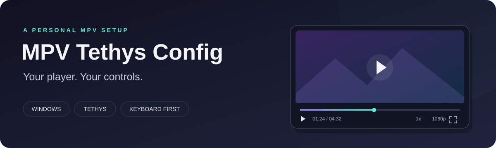

<div align="center">



# MPV Tethys Config

**A borderless MPV setup for Windows, with Tethys controls, streaming tools, and a keyboard-first workflow.**

[Get started](#get-started) · [Keyboard shortcuts](docs/KEYBINDINGS.md) · [Customize](docs/CUSTOMIZATION.md) · [Troubleshooting](docs/TROUBLESHOOTING.md)

</div>

This repository contains the configuration and scripts. Install MPV separately, copy in `portable_config`, and make it your own. No player binaries, watch history, account cookies, or personal state are included.

> **Status:** a shareable personal configuration, with known issues documented in [Known issues](docs/KNOWN_ISSUES.md). It is designed for Windows 11 and D3D11-capable graphics. It is not a cross-platform preset or a fully tested release.

## What you get

| Feature | What it does |
|---|---|
| **Tethys interface** | Borderless player, icon controls, seekbar, track controls and custom menus. |
| **Quality menu** | Press **F6** to choose a stream resolution, or downscale a local file (1080p, 720p, 480p ...); **Alt+W** opens audio. The Tethys bar shows the current resolution. |
| **Clipboard playback** | Press **Ctrl+V** to open a copied URL or path; supported URL timestamps are applied after loading. |
| **Watch history** | **Ctrl+H** opens a history grid; **Ctrl+G** browses a YouTube channel's prefetched uploads. |
| **Picture-in-picture** | **P** toggles a smaller always-on-top window. |
| **Clear feedback** | Custom volume, seek, speed and play/pause indicators. |
| **Remembered preferences** | Volume, mute, speed and subtitle preferences persist between sessions. |
| **Folder playback** | Nearby videos/audio are added to the playlist with natural filename sorting. |
| **Downloads** | **Ctrl+D** starts yt-dlp for the current network URL. |
| **Optional extras** | Loading covers, browser cookies and SponsorBlock are available separately or disabled by default. |

The banner above is an illustration, not a screenshot of playback.

## Get started

### 1. Install MPV

Download a Windows build linked on the [official MPV installation page](https://mpv.io/installation/). Choose a build with **LuaJIT/FFI**, which the Windows styling and focus helpers use.

Extract the **entire player archive** into a folder you can write to, for example `C:\Apps\mpv`. Keep its companion DLLs together with `mpv.exe` and `mpv.com`.

The author's player at packaging time reports `mpv v0.41.0-1227-ge471496c5` (21 October 2026). This records the environment, not a promise that every feature has been tested with that build.

### 2. Add this configuration

Download this repository with **Code → Download ZIP**, then extract it. Copy the repository's **`portable_config` folder** next to `mpv.exe`:

```text
C:\Apps\mpv\
├── mpv.exe                 ← from your MPV download
├── mpv.com                 ← from your MPV download
├── ...companion DLLs       ← from the same player archive
└── portable_config\        ← from this repository
    ├── mpv.conf
    ├── input.conf
    ├── scripts\
    ├── script-modules\
    └── script-opts\
```

**Already have a configuration?** Back up your existing `portable_config` first. Combining multiple OSCs or window-management scripts can cause conflicts; start with this folder as a whole instead of blindly merging scripts.

MPV automatically uses `portable_config` beside its executable. You do not need to place these files in AppData as well.

### 3. Add the tools you need

Local video playback needs MPV. Additional features use these tools:

| Tool | Needed for | Where to put it |
|---|---|---|
| [yt-dlp](https://github.com/yt-dlp/yt-dlp#installation) | YouTube/site extraction, quality selection, channel lists and downloads | Download the official standalone **`yt-dlp.exe`** into `portable_config`. |
| [FFmpeg](https://ffmpeg.org/download.html#build-windows) | History thumbnails and optional loading covers; merging some downloads | Put `ffmpeg.exe` on **PATH**. For yt-dlp merging, make `ffprobe.exe` available too. |
| [Deno](https://docs.deno.com/runtime/getting_started/installation/) | JavaScript challenges used by current yt-dlp YouTube extraction | Install it on PATH. See [yt-dlp's JavaScript guidance](https://github.com/yt-dlp/yt-dlp/wiki/EJS). |
| [Python 3](https://www.python.org/downloads/windows/) | Optional SponsorBlock helper | Make the `python` command available on PATH. It is not required by the standalone yt-dlp executable. |
| [Montserrat](https://fonts.google.com/specimen/Montserrat) | The intended interface/subtitle typography | Install the **ExtraBold** weight, or choose another installed font in the configuration. |

PATH means Windows can find a program by its name from any terminal. Reopen MPV after installing tools or changing PATH.

### 4. Play something

Drag a local video onto `mpv.exe`, or open MPV and press **Ctrl+V** with a video URL in your clipboard.

Try **Space** to pause, **F** for fullscreen, **P** for PiP and **Ctrl+H** for history. **F5** displays the player version and active decoder. See the [full shortcut guide](docs/KEYBINDINGS.md).

## Everyday controls

| Key | Action |
|---|---|
| **Space** | Play / pause |
| **F / Enter** | Toggle fullscreen; **Esc** leaves fullscreen |
| **← / →** | Request a one-second seek backward / forward |
| **↑ / ↓** or **mouse wheel** | Volume ±5 |
| **M** | Mute |
| **W / S** | Speed ±0.1× |
| **F1 / F2 / F3** | Set speed to 2× / 1.5× / 1× |
| **F6 / Alt+W** | Video / audio quality menu (stream formats, or resolution for local files) |
| **Right-click** | Play / pause |
| **Ctrl+V** | Play the clipboard URL/path |
| **Ctrl+H / Ctrl+G** | Watch history / YouTube channel uploads |
| **P** | Toggle picture-in-picture |
| **R** | Cycle looping: current video → playlist → off |
| **Alt+S** | Save a PNG screenshot |
| **Q** | Quit |

**Replay from the start:** right-click the Tethys play button. At the end of a video, its play button becomes Replay. **R cycles looping; it is not the restart shortcut.**

Default MPV keys are disabled. Keys not listed in `input.conf` may be unavailable; forced controls inside menus still work.

## Make it yours

- **Interface size and colors:** `portable_config/script-opts/tethys.conf`.
- **Video, subtitles and cache limits:** `portable_config/mpv.conf`.
- **Keyboard shortcuts:** `portable_config/input.conf`.
- **Download destination:** `portable_config/script-opts/ytdlp_download.conf`. The default is your user folder's `Downloads/mpv`, with partial files in `_incomplete`.
- **Optional loading covers:** set `enabled=yes` in `script-opts/loading_preview.conf`. The current implementation can slow startup, so the shared preset leaves it off.
- **Browser cookies:** off by default; enable only when needed in `script-opts/cookies_auto.conf`, using your own profile.
- **SponsorBlock:** included under [`extras/sponsorblock`](extras/sponsorblock/README.md), outside the auto-loaded scripts. Read its known issue before enabling it.

Most changes need an MPV restart. The [customization guide](docs/CUSTOMIZATION.md) explains the renderer profiles, font settings, scripts and optional features.

## Updating

**MPV:** close it, back up your install, and replace the program files using a fresh archive from your build provider. Keep companion files from that archive together. Preserve your `portable_config` and check the new version's compatibility notes.

**yt-dlp:** from the installed player directory:

```powershell
.\portable_config\yt-dlp.exe -U
```

**This configuration:** compare changes before replacing your files, especially `input.conf`, script options and runtime preferences. Several third-party scripts have local modifications; replacing them with upstream copies may remove custom behavior.

## What's in this repository?

```text
mpv-tethys-config/
├── README.md
├── portable_config/        # copy this next to mpv.exe
├── extras/sponsorblock/    # optional integration, disabled by placement
├── docs/                   # shortcuts, customization, troubleshooting, known issues
│   └── assets/banner.svg
├── licenses/               # retrieved upstream license/copyright texts
├── tests/                  # mocked regression checks and Lua syntax checks
├── THIRD_PARTY_NOTICES.md
├── SHARING_NOTES.md        # how the private setup was prepared for sharing
└── .gitignore              # keeps generated state and downloaded binaries out of Git
```

Runtime history, preferences, window state, screenshots, caches, SponsorBlock identity, executables and DLLs are intentionally absent. MPV creates the runtime data it needs after installation. **Do not upload your used player directory as a replacement for this clean source folder.**

## Testing

From this repository's root, with `mpv.com` on PATH:

```powershell
mpv.com --no-config --load-scripts=no --idle=yes --vo=null --ao=null --script=tests/regressions.lua
mpv.com --no-config --load-scripts=no --idle=yes --vo=null --ao=null --script=tests/syntax.lua
mpv.com --no-config --load-scripts=no --idle=yes --vo=null --ao=null --script=tests/download_paths.lua
```

These checks do not play personal files, extract cookies, or invoke network tools. They are targeted checks, not a guarantee that the desktop/streaming integrations are bug-free. See [known issues](docs/KNOWN_ISSUES.md) and [troubleshooting](docs/TROUBLESHOOTING.md) before reporting a problem.

## Credits and licensing

Built around [MPV](https://mpv.io/) and [Zren's Tethys OSC](https://github.com/Zren/mpv-osc-tethys), with [quality-menu](https://github.com/christoph-heinrich/mpv-quality-menu), MPV's autoload script and optional [mpv_sponsorblock](https://github.com/po5/mpv_sponsorblock). Tethys also incorporates other upstream work.

See [third-party notices](THIRD_PARTY_NOTICES.md) for origins, local modifications and licensing details. There is **no blanket MIT license** applied to this mixed-source collection. Existing third-party licenses and notices remain applicable; Tethys' overall license provenance still needs clarification.
